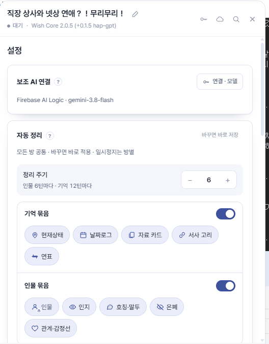
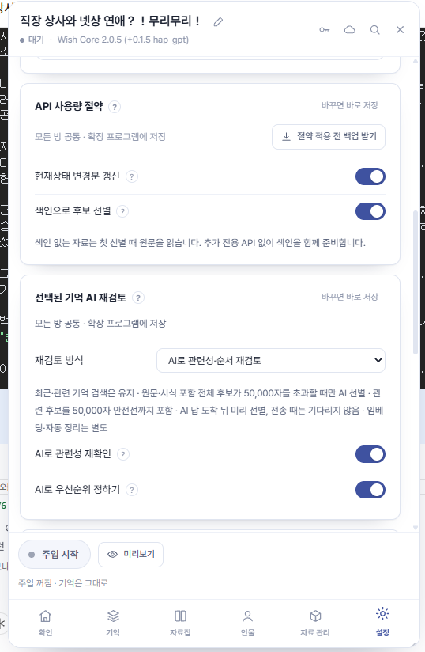
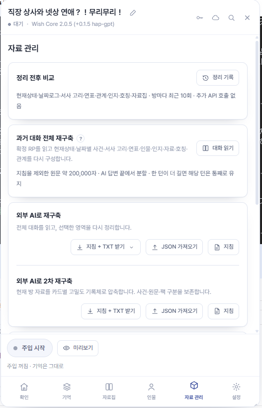

## 1. 처음에는 OFF — 주입 시작 누르기

처음 시작할 때는 **OFF** 상태임. 작성한 내용을 대화에 넣으려면 **주입 시작**을 눌러야 함.

- **5만 자 이하**라면 켜진 항목의 원문과 서식을 포함한 주입 후보가 모두 들어감.
- **5만 자를 넘으면** 최근 기억과 현재 문맥에 관련된 날짜로그·자료가 선택되어 들어감. 저장된 기억 자체가 삭제되는 것은 아님.

설정의 **API 사용량 절약**과 **선택된 기억 AI 재검토**는 별도 카드임. API 사용량 절약의 **색인으로 후보 선별**은 요청에 쓸 짧은 색인을 재사용하고, 선택된 기억 AI 재검토는 후보의 관련성·순서를 검토함. AI 재검토는 전체 후보가 5만 자를 넘을 때 사용하며, 전송 시에는 준비된 점수를 사용하거나 최근·키워드 순위로 보냄. 자료를 작성했는데도 반영되지 않는 것 같다면 먼저 주입이 켜져 있는지 확인할 것.

## 2. 유저노트와 지침 넣기

유저노트나 대화 지침은 **기억 → 기타·OOC**에 넣으면 됨.

매번 사용하는 지침은 **기본 프리셋**에 미리 넣어 두면 됨. 새 방을 열면 기타 슬롯에 자동으로 들어감. 기존 방에도 바로 넣고 싶다면 **저장하고 이 방에도 적용**을 선택함.

## 3. 자동정리 주기 정하기

`설정 → 자동 정리`의 **정리 주기 입력값은 인물 정리 주기**임. 기억은 설정한 값의 두 배 간격으로 정리됨.

예를 들어 **4턴으로 설정하면 인물은 4턴마다, 기억은 8턴마다** 정리함.

| 정리 주기 설정값 | 인물 정리 | 기억 정리 |
| --- | --- | --- |
| 4턴 | 4턴마다 | 8턴마다 |
| 6턴 | 6턴마다 | 12턴마다 |
| 8턴 | 8턴마다 | 16턴마다 |

상세하게 정리하고 싶다면 설정값 4턴, 중간 정도라면 6턴, 간격이 넓어도 괜찮다면 8턴을 참고하면 됨. 기본값은 인물 5턴·기억 10턴임.

주기는 취향에 맞춰 조정하면 됨. 설정은 모든 방에 공통 적용되고, 일시정지와 정리한 위치는 방마다 유지됨. 한 턴은 USER 메시지와 AI 답변 한 쌍이며, 리롤은 같은 턴임.

**기억·인물 주기가 겹치면 같은 AI 요청으로 처리함.** 현재 배포본은 두 주기를 독립적으로 지정하거나 인물만 한 턴 먼저 실행하도록 설정하는 구조가 아님. 외부 AI 복붙 모드에서는 API 자동정리를 사용하지 않음.

<figure class="guide-figure"><figcaption>설정 탭 · 정리 주기 입력값과 기억·인물 묶음 항목을 확인할 수 있음.</figcaption></figure>

<figure class="guide-figure"><figcaption>설정 탭 · API 사용량 절약과 선택된 기억 AI 재검토 항목.</figcaption></figure>

## 4. 인물에 모브 추가하기

**인물 → 캐릭터**에서 모브를 추가할 수 있음.

`기억 → 기타·OOC`에 적는 방법도 있음. 캐릭터의 **자동 감지**를 끄면 켜진 카드는 매 턴 포함되고, 켜면 문맥에 따라 자동 포함됨. 캐릭터에도 별도의 **기본 프리셋**이 있음.

## 5. 외부 AI로 재구축하기 · HAP-GPT

HAP-GPT에서는 **자료 관리 → 외부 AI로 재구축** 작업을 **GPT로 바로 보내는 기능**이 있음.

1. 자료 관리의 **외부 AI로 재구축**에서 **지침 + TXT 받기** 또는 **지침 + ZIP 받기**를 열고 재구축 영역을 선택함.
2. **GPT 전송**으로 자료와 요청 문구를 보냄.
3. ChatGPT에서 첨부 내용과 문구를 확인하고 전송함.
4. GPT의 작업이 끝나면 완성된 결과물을 가져옴.
5. 결과를 만들었던 **외부 AI로 재구축** 영역의 **JSON 가져오기**로 가져오고, 검증·적용 화면을 확인함.

**GPT로 보냈다고 결과가 자동 적용되지는 않음.** 완성물을 가져와 JSON 가져오기를 해야 함.

<figure class="guide-figure"><figcaption>자료 관리 탭 · 외부 AI 결과는 해당 재구축 영역의 JSON 가져오기로 적용함.</figcaption></figure>

[GPT 전송과 보조 AI 연결 자세히 보기 →](gpt.html)

## 6. 분기 만들기와 다른 방으로 복사하기

분기나 새 방에 기존 자료를 넣으려면 **자료를 받을 방**을 먼저 엶.

1. **자료 관리 → 다른 방 자료 복사하기**에서 **다른 방에서 선택 복사**를 누름.
2. 원본 방을 선택하고 필요한 섹션·사건·카드를 고름.
3. 현재 방으로 복사할 내용을 확인함.

원본과 연결되지 않는 **독립 사본**으로 복사됨. 이후 한쪽을 수정해도 다른 쪽은 바뀌지 않음. 주입 중 상태나 자동화 실행 상태는 옮기지 않음.

## 7. 로컬 데이터가 많아졌을 때

`자료 관리 → 백업 · 복원 → 로컬 데이터 정리`에서 사용하지 않는 방의 자료를 정리할 수 있음.

삭제 전에는 필요한 방이 포함되지 않았는지 확인하고, 남겨 둘 자료는 먼저 [백업](backup.html)할 것.

## 보조 AI 추천 설정

처음 설정할 때는 아래 조합을 추천함. 실제 선택은 연결 화면에서 제공하는 모델과 추론 강도에 맞추면 됨.

| 모델 | 추천 추론 강도 |
| --- | --- |
| Gemini 3.8 | 보통 / 낮음 |
| Gemini 3.7 | 보통 / 낮음 |
| GPT 5.6 Sol | 낮음 |
| GPT 6.1 Sol | 낮음 |

위 표는 이 설명서의 사용 추천값임. 공급자·계정에 따라 표시되는 모델이 다를 수 있음. ChatGPT 구독은 브리지에서 모델 목록을 새로고침해 확인할 것.

## 설치본 확인이 필요하다면

HAP-GPT는 Tampermonkey가 동작하는 브라우저에 설치함.

1. 기존 자료를 백업함.
2. 기존 Wish Core·Cloud Patch·HAP 스크립트를 끔.
3. [공개 HAP-GPT 배포 폴더](https://github.com/eun033/RpCleanerEpub/tree/main/main/wish-core-hap-gpt)의 최신 안내를 확인함.
4. `Wish_RP_Core_HAP_GPT.user.js`를 설치하고 켬.
5. Crack 페이지를 새로고침하고 상단 버전을 확인함.

개발 브랜치와 공개 배포본의 버전은 다를 수 있음. ChatGPT 구독을 연결하려면 [GPT 브리지 안내](bridge.html)를 이어서 읽으면 됨.
